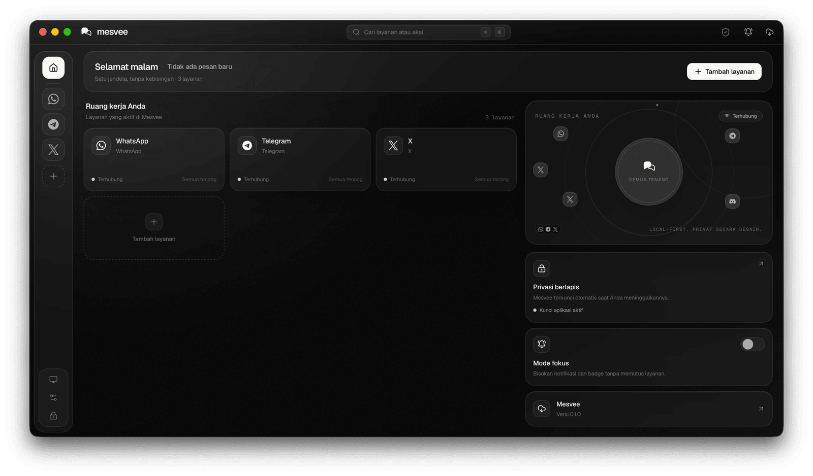
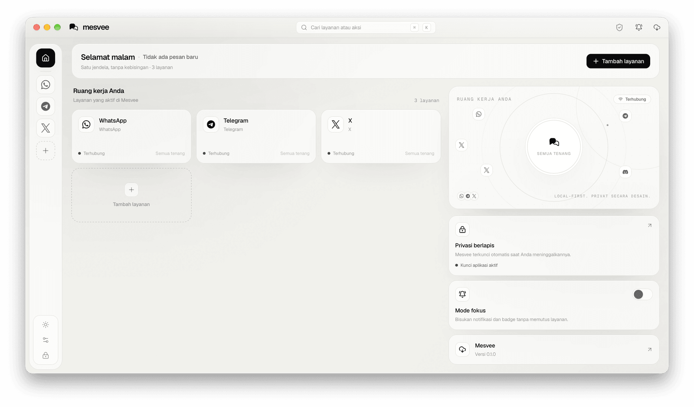
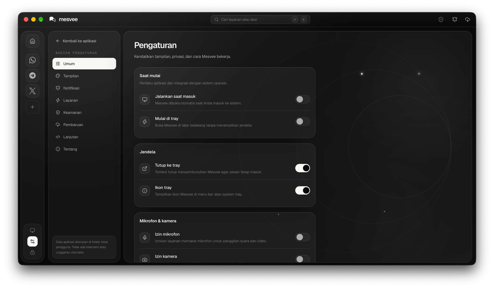
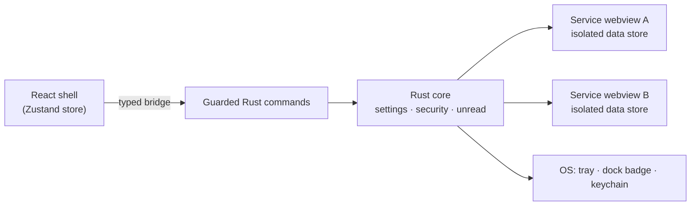

<div align="center">


# Mesvee

**Satu jendela tenang untuk semua pesan dan media sosial Anda.**

*One calm window for all your messaging and social accounts.*

WhatsApp · Telegram · Instagram · Slack · Discord · and more — unified, private, and beautifully glassed.

<br />

[](package.json)
[](https://v2.tauri.app)
[](https://www.rust-lang.org)
[](https://react.dev)
[](https://www.typescriptlang.org)
[](https://tailwindcss.com)


[](LICENSE)

[Quick Start](#-quick-start) ·
[Features](#-features) ·
[Architecture](#-how-it-works) ·
[Documentation](#-documentation) ·
[Contributing](#-contributing)

<br />



</div>

---

## ✨ Overview

Mesvee is a cross-platform desktop client that unifies messaging and social networks into one fast, private window. Think Rambox, Ferdium or Beeper — but native: a **Rust core**, **per-account OS-isolated webviews**, and a **black-and-white glassmorphism** interface.

## 🎯 Why Mesvee

| Problem with browser tab soup | What Mesvee does |
| --- | --- |
| 20 tabs, 20 notification icons, constant context switching | One window, one rail, every account one click away |
| All accounts share one browser profile | Every account gets an **isolated native data store** (own cookies, own storage) |
| Web clients eat RAM as separate full browsers | One process, shared system webviews, no bundled Chromium |
| Unread counts scattered everywhere | A single unread badge on the rail, the dock badge and the window |
| Apps that phone home | **Local-first**: no Mesvee account, no telemetry, settings stored on disk |

## 🚀 Features

<table>
<tr>
<td width="50%" valign="top">

### 🎨 Design
- Dark / light / **system** theme with live OS-palette watcher
- Black-and-white **glassmorphism** design tokens
- **Indonesian + English** (ID default), parity enforced by types and tests
- Generated monochrome app icon for every platform

### 🔔 Productivity
- Push notifications via an authenticated per-service JS bridge
- Flood protection, focus mode, dock/tray badge
- Command palette and quick account switching
- In-app updates with progress UI and auto-check toggle

</td>
<td width="50%" valign="top">

### 🔐 Security & Privacy
- **App lock**: 4–8 digit PIN, recovery code, idle auto-lock, lock on focus loss
- Argon2id PIN hashing + OS keychain
- Shell-only command guard and URL/navigation policy
- Isolated sessions per account, screen-capture protection
- Signed updates (minisign) — see [SECURITY.md](docs/SECURITY.md)

### 🛠 Engineering
- Clean layered architecture (Rust core ↔ typed bridge ↔ Zustand ↔ UI)
- Atomic settings writes, crash boundary + Rust panic hook
- Rotating file logs, redacted diagnostics export
- Unit, Rust and Playwright e2e tests

</td>
</tr>
</table>

<details>
<summary><b>Full feature matrix</b></summary>

<br />

| # | Requirement | Where it lives |
| --- | --- | --- |
| 1 | Dark / light / **system** theme | `Settings → Appearance`, `src/lib/appearance.ts` |
| 2 | Black-and-white **glassmorphism** | Design tokens in `src/index.css` (`.glass`, `.glass-strong`, `.app-canvas`) |
| 3 | **Indonesian + English** | `src/core/i18n/locales` |
| 4 | Complete system + app settings | `src/features/settings/SettingsScreen.tsx` — 8 sections, ~40 controls |
| 5 | Push notifications | `tauri-plugin-notification` + per-service JS bridge |
| 6 | Clean architecture | Rust domain core ↔ guarded commands ↔ typed bridge ↔ Zustand ↔ UI |
| 7 | Production ready | Atomic settings, crash boundary, structured logs, tests |
| 8 | Multi-layer security | [docs/SECURITY.md](docs/SECURITY.md) |
| 9 | **App lock** | PIN, recovery code, idle/focus lock, capture protection |
| 10 | Generated app icon | `scripts/generate-icons.mjs` (`.icns`, `.ico`, PNGs, tray) |
| 11 | In-app update | `tauri-plugin-updater` with minisign verification |
| 12 | Version bump | `pnpm run bump:patch\|minor\|major` syncs 5 manifests atomically |
| 13 | Commented code | Doc comments on every module and function |
| 14 | Complete documentation | [docs/](docs/) |
| 15 | Errors, crashes, logging | `ErrorBoundary`, Rust panic hook, rotating logs |

</details>

## 📸 Screenshots

<div align="center">

| Dark | Light |
| :---: | :---: |
|  |  |



</div>

## ⚡ Quick Start

### Prerequisites

- **Node** ≥ 22.12 and **pnpm** ≥ 10
- **Rust** ≥ 1.90 (`rustup` default toolchain)
- [Tauri 2 platform prerequisites](https://v2.tauri.app/start/prerequisites/) — macOS: Xcode CLT; Linux: `webkit2gtk-4.1`, `libayatana-appindicator3`; Windows: MSVC toolchain

### Run

```bash
git clone https://github.com/cybersafetyid/Mesvee.git && cd Mesvee
pnpm install            # JS dependencies (lockfile is authoritative)

pnpm run dev            # Vite + `tauri dev` — full native app
pnpm run dev:web        # web-only preview against the mock bridge
```

> [!NOTE]
> The first launch shows onboarding; everything afterwards is offline-first.

## 🧰 Commands

| Command | What it does |
| --- | --- |
| `pnpm run dev` | Native development (HMR for React, auto-rebuild of Rust) |
| `pnpm run dev:web` | Browser-only shell with a mock backend for design review |
| `pnpm run build` | Production bundle (icons, bundle, updater artifacts) |
| `pnpm run build:web` | Frontend only (`tsc --noEmit && vite build`) |
| `pnpm run typecheck` | Strict TypeScript, no emit |
| `pnpm run test` | Vitest unit tests |
| `pnpm run test:rust` | Rust unit tests (`cargo test`) |
| `pnpm run test:e2e` | Playwright end-to-end flow |
| `pnpm run check` | typecheck + unit tests + Rust tests in one gate |
| `pnpm run icons` | Regenerate every monochrome icon/tray asset |
| `pnpm run bump:patch` / `:minor` / `:major` | Bump version, generate `CHANGELOG.md`, commit, tag and push (triggers the release build; `--dry-run`, `--no-push`) |

## 🏗 Project Structure

```
Mesvee/
├── src/                        # React renderer (no Tauri imports outside core/bridge)
│   ├── main.tsx                # entry: theme pre-paint, root mount
│   ├── App.tsx                 # boot, routing, appearance projection, overlays
│   ├── index.css               # design tokens: glass surfaces, motion, density
│   ├── app/                    # shell: Titlebar, Rail, ErrorBoundary
│   ├── core/                   # domain layer
│   │   ├── types.ts            # shared serializable contracts
│   │   ├── store.ts            # Zustand store (projection of Rust state)
│   │   ├── bridge/             # MesveeBridge interface + tauri/mock adapters
│   │   └── i18n/               # i18next setup + id/en locale trees
│   ├── features/               # home, service, settings, lock, palette, onboarding
│   ├── ui/                     # primitives: Button, Controls, Form, Modal, Toasts
│   └── lib/                    # appearance, clipboard, platform helpers
├── src-tauri/                  # Rust core
│   ├── src/lib.rs              # builder: plugins, setup, lifecycle events
│   ├── src/commands/           # the only IPC surface (guarded by webview label)
│   ├── src/services/           # catalog, isolated webviews, unread, notifications
│   ├── src/security/           # Argon2id PIN, keychain storage, idle watcher
│   ├── src/settings.rs         # validated, atomically-persisted settings
│   └── src/logging.rs          # rotating file logs + panic hook
├── scripts/                    # icons, service glyphs, version bump
├── tests/unit/                 # Vitest suites
└── docs/                       # architecture, security, development, release
```

## 🔬 How It Works



1. **Boot** — Rust loads settings, initializes the keychain, applies theme/autostart/tray, and reveals the window only after the first successful paint (no white flash).
2. **IPC** — Every command is validated in Rust. `commands::guard::ensure_shell` rejects anything not from the trusted `main` webview.
3. **Services** — Each account is a child webview with its own `data_store_identifier` / `data_directory`, hardened permissions, and a safe-URL navigation policy.
4. **Workspace sync** — React measures a placeholder region and streams exact logical bounds to `sync_workspace`; Rust parks the active webview over it and hides the others.
5. **Unread** — Rust parses document titles (`(3) Telegram`, `4 unread`, …), caps badges, aggregates non-muted accounts, and pushes the OS dock/tray badge.
6. **Lock** — Idle watcher, focus-loss and manual lock converge on `lock_workspace`: webviews are suspended, capture protection applied, and the keypad shown.

## 📚 Documentation

| Document | Contents |
| --- | --- |
| [ARCHITECTURE.md](docs/ARCHITECTURE.md) | Layers, data flow, process model, state ownership |
| [SECURITY.md](docs/SECURITY.md) | Multi-layer security model and threat mitigations |
| [DEVELOPMENT.md](docs/DEVELOPMENT.md) | Conventions, adding a service, i18n workflow, debugging |
| [RELEASE.md](docs/RELEASE.md) | Versioning, auto-changelog, CI/CD release, signing, updater |
| [CHANGELOG.md](CHANGELOG.md) | Release history, generated from commits |

## ✅ Testing

```bash
pnpm run check        # typecheck + unit tests + Rust tests
pnpm run test:e2e     # Playwright: onboarding → home → palette → settings → lock → add service
```

The Rust suite covers security-sensitive surfaces (PIN policy, keychain, navigation policy, catalog integrity, unread parsing, settings validation). The TS suite covers IPC error normalization, locale parity/interpolation, and theme/motion projection.

## 🤝 Contributing

1. Read [DEVELOPMENT.md](docs/DEVELOPMENT.md) for conventions.
2. Create a branch, make focused changes, and keep code commented.
3. Run `pnpm run check` before opening a pull request.
4. Report security issues privately — see [SECURITY.md](docs/SECURITY.md).

## 📄 License

Mesvee is free software licensed under the [GNU General Public License v3.0](LICENSE) — © 2026 Mesvee.

Third-party terms apply to every service you add inside the app.

<div align="center">

<sub>Built with Tauri, Rust, React and a lot of glass.</sub>

</div>
